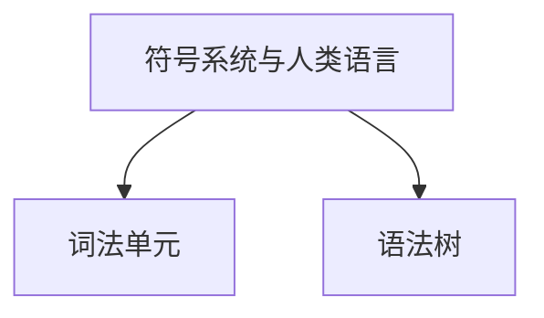

# 探索性学习模式 — 设计计划

> 状态：设计定稿（2026-10-23），尚未实施。
>
> 本文是 **实施前的唯一权威设计文档**。实施过程中的偏离必须先更新本文，再改代码。
>
> 相关文档：`TECH_SPEC.md`（整体架构）、`CONTEXT.md`（领域术语）、`docs/llm-runs-schema.md`（LLM 调用记录）。

---

## 0. 一句话形态

选中若干 Markdown 笔记 → 一次性生成「魔改后」的知识脉络图 → 以脉络图为唯一进度主轴，逐点苏格拉底式提问 → 每轮把对应知识以白板快照呈现 → 覆盖完毕自动导出可回放的学习史。

对外中文名：**探索性学习**。
代码命名：`exploration`（短、稳定、不与既有 `quiz` / `diagnosis` 混淆）。
教学法溯源（文档里作为别名记录，不进入代码标识符）：
**Guided Discovery Learning（引导发现学习）**，提问方法属 **Socratic / Inquiry-Based Learning（苏格拉底式探究）**。

---

## 1. 目标与非目标

### 目标

- 以**知识脉络**而非文档结构驱动学习顺序：浅 → 深，跨文档重组（"魔改"）。
- 每一问必须落到文档真实内容，并携带 `source_refs` 溯源（笔记路径 + 标题 + 片段）。
- 白板按轮次版本化，支持 `/undo`、`/redo` 与步进回放。
- 学习史导出为**人可读 + 机可解析**的单一 Markdown，可再导入、只读回放、`/btw`、从末端续学。
- 双运行时（Tauri 桌面 / Axum Web）行为一致。

### 非目标（本期不做）

- 多人协作、实时共享。
- 自由手绘白板（白板内容由 AI 生成）。
- 非 Markdown 源文件直接参与：PDF / DOCX / PPTX / HTML 必须先经「文档转换」成为笔记。
- Mermaid 运行时渲染（只做纯文本双向转换，不引入依赖）。

---

## 2. 交互与布局

复刻现有三栏骨架，只替换中 / 右两栏内容，不新增布局代码。

| 栏位 | 阅读模式 | 探索模式 |
|---|---|---|
| 左 `aside` | `Explorer` | `Explorer` + 多选复选框 + 底部模式按钮 |
| 中 `main` | `Reader` | `ExplorationChat`（会话流） |
| 右 `aside` | `PanelContainer` | `ExplorationPanel` = 状态区 + 白板区 |

- 复用 `explorerWidth` / `readerWidth`（后者是**右侧**宽度，注意命名陷阱）、拖拽把手、`Ctrl+B` / `Ctrl+Shift+B` 折叠。
- 模式入口：`Explorer` **底部按钮**。`TitleBar` 保持只显示笔记标题，不做修改。
- 当前模式持久化到 `settings.ui.last_mode`（`"reader"` | `"exploration"`）。
- 空态：
  - 未勾选文件 → 中栏引导卡片（说明会做什么、需要几个文件）。
  - 初始化中 → 右栏显示 `Initialise` + 阶段文字（`分析文档 → 抽取概念 → 编排脉络`）。
- 白板更新时机：**用户回答之后**（与需求一致），不是提问时。
- 右侧栏结构：`Status`（阶段 / `覆盖 3/12` / 当前概念高亮）+ `Whiteboard`（Markdown 渲染，复用现有 MarkdownIt + KaTeX + highlight.js 管线）。

---

## 3. 状态机

```
Idle
  │ 勾选 ≥1 个 .md，点击「开始」
  ▼
Initializing
  ├── 无跨域 ──────────────────────────────▶ GraphReady
  └── 检测到多领域 ──▶ AwaitingDomainConfirm ──确认/改名/合并/拆分──▶ GraphReady
                                                                      │ 推送首问
                                                                      ▼
                                                                   Active
                                                    Active ⇄ /undo ⇄ /redo
                                                                      │
                     ┌── 全部 concept 均 covered ──▶ Completed ──自动导出──▶ Exported
                     └── 用户「提前结束」──────────▶ Completed(partial)
                                                                      
Imported ──只读──▶ Replay(步进)
Imported ──「从此继续」──▶ Active(副本, imported_from=源路径)
```

补充规则：

- `Initializing` 中取消 → 会话保留在 `Initializing`，摘要缓存落盘，可重试。
- `Completed` 之后仍允许只读浏览；不再接受新回答。
- 从 `Imported` 副本继续后，副本是独立会话，导出为新文件。

---

## 4. 数据模型

Rust 与 TypeScript 镜像，序列化统一 `snake_case`。

```rust
struct ExplorationSession {
    id: String,                       // uuid，去连字符
    title: String,
    format_version: u32,              // = 1
    created_at: String,               // RFC 3339
    updated_at: String,
    status: SessionStatus,            // Initializing | AwaitingDomainConfirm | Active | Completed
    origin: SessionOrigin,            // New | Imported { source_path }
    source_paths: Vec<String>,        // 相对 note root
    graph: KnowledgeGraph,
    groups: Vec<TurnGroup>,
    active_group: usize,              // 游标；< groups.len() 表示有可 /redo 的尾部
    domain_warning: Option<String>,
    completed_early: bool,
}

enum SessionStatus { Initializing, AwaitingDomainConfirm, Active, Completed }

enum SessionOrigin {
    New,
    Imported { source_path: String },
}

struct KnowledgeGraph {
    concepts: Vec<Concept>,
    domains: Vec<Domain>,
    root_order: Vec<String>,          // 顶层 concept 展示顺序
    domains_confirmed: bool,
}

struct Concept {
    id: String,
    title: String,
    summary: String,
    depth: u32,                       // 0 = 最浅
    prereqs: Vec<String>,             // concept id
    source_refs: Vec<SourceRef>,
    covered: bool,
}

struct Domain {
    id: String,
    title: String,
    concept_ids: Vec<String>,
}

struct SourceRef {
    note_path: String,                // 相对 note root
    heading: Option<String>,
    snippet: String,                  // ≤ 200 字符
}

struct TurnGroup {
    concept_id: String,
    question: Question,
    answer: Option<String>,
    result: Option<TurnResult>,       // verdict / feedback / next_action / hint
    whiteboard: Option<WhiteboardStep>,
    covered_after: Vec<String>,       // 该轮新增覆盖的 concept id
}

struct Question {
    prompt_md: String,
    hint_used: bool,
}

struct TurnResult {
    verdict: Verdict,                 // Correct | Partial | Wrong | Unknown
    feedback_md: String,
    next_action: NextAction,          // Question | Hint | Advance | Complete
    hint: Option<String>,
}

struct WhiteboardStep {
    id: String,
    concept_id: String,
    title: String,
    content_md: String,
    group_index: usize,
}
```

### 撤销 / 重做的状态推导（关键设计）

- 不维护独立的撤销栈，**只移动 `active_group` 游标**：
  - `/undo` → `active_group -= 1`（保留尾部，供 `/redo`）
  - `/redo` → `active_group += 1`
  - 在 `active_group < groups.len()` 时提交新回答 → **截断尾部**（`groups.truncate(active_group)`），旧的重做历史丢弃。
- `covered` 不持久化为权威状态，而是由 `groups[..active_group]` 的 `covered_after` **重算**。
  ⇒ 撤销 / 重做天然一致，无隐藏状态可漂移。
- 当前白板内容 = `groups[active_group - 1].whiteboard`。
- `/btw` 旁支不进入 `groups`，单独存放（见 §9），因此不影响游标与覆盖。

> 实施时 `groups` 里 `question` 先落盘，`answer` / `result` 在下一轮返回后补全；任何时刻允许 `answer.is_none()` 的尾部组（会话中断可恢复）。

---

## 5. 后端设计

### 5.1 模块

```
src-tauri/src/services/exploration/
  mod.rs
  models.rs          # 上述结构 + serde
  graph.rs           # map-reduce 图谱生成、校验、去环、拓扑排序、分域聚类
  engine.rs          # 单次轮次调用 + JSON 修复重试 + 覆盖推进
  session_store.rs   # 持久化，仿 diagnosis_session_service
  prompt.rs          # 提示词模板与 JSON schema 片段
```

`graph.rs` 依赖 `note_service::note_content_for_prompt` 的截断策略；`engine.rs` 复用 `quiz_engine::call_llm` 漏斗（自动获得 `llm_runs` 记录）。

### 5.2 LLM 调用 kind 扩展

`LlmRunKind` 新增：

- `exploration_summary` — map-reduce 的分段摘要
- `exploration_graph` — 合并生成最终图谱
- `exploration_turn` — 每轮合并调用
- `exploration_repair` — JSON 解析失败后的单次修复
- `exploration_aside` — `/btw`

### 5.3 命令与路由（必须成对）

| Tauri 命令 | Axum 路由 | 说明 |
|---|---|---|
| `exploration_start_stream` | `POST /api/exploration/start` | SSE；可能先发 `DomainWarning` |
| `exploration_confirm_domains` | `POST /api/exploration/domains` | 确认领域后继续生成图谱并推首问 |
| `exploration_ask_stream` | `POST /api/exploration/ask` | 1 次调用出反馈 + 下题 + 白板 |
| `exploration_undo` | `POST /api/exploration/undo` | 纯状态操作，无 LLM |
| `exploration_redo` | `POST /api/exploration/redo` | 同上 |
| `exploration_list` | `GET /api/exploration/sessions` | 列表（摘要） |
| `exploration_get` | `GET /api/exploration/sessions/:id` | 单个会话 |
| `exploration_delete` | `DELETE /api/exploration/sessions/:id` | 删除 |
| `exploration_finish` | `POST /api/exploration/sessions/:id/finish` | 提前结束 |
| `exploration_export` | `POST /api/exploration/sessions/:id/export` | 自动导出到 app-data |
| `exploration_save_to_vault` | `POST /api/exploration/sessions/:id/save` | 显式目标路径，写 vault |
| `exploration_import` | `POST /api/exploration/import` | 创建副本 |

### 5.4 流事件

```
Phase { phase }
DomainWarning { clusters: [{ title, note_paths }] }
GraphReady { graph }
Chunk { content }              # 助手流式文本
TurnResult { group_index, ... } # 结构化结果 + 白板
Completed { early, uncovered }
Done { session_id }
Error { message }
```

标签联合 shape 与既有 `QuizStreamEvent` / `DiagnosisStreamEvent` 保持一致：`{ "event": "...", "data": { ... } }`，字段 `snake_case`。前端 `src/services/exploration.ts` 必须同时处理 Tauri `Channel` 与 SSE，共用同一个 dispatch 函数。

### 5.5 存储

```
<data>/exploration/
  sessions/<id>.json         # 会话（含 groups、whiteboard 快照）
  summaries/<hash>.json      # map-reduce 分段摘要缓存（按 note_path + mtime 失效）
  exports/<title>-<yyyyMMdd-HHmm>.md
```

- `sessions/`、`summaries/` 加入 `MANAGED_DATA_FILES`（备份白名单）；`exports/` 不加入（可重新生成）。
- 过期清理：沿用 `diagnosis_session_service` 的 7 天 TTL，仅清理 `status != Active` 且无引用的会话。
- 所有写入走 `atomic_write` + `.bak` 回退（与 `settings.json` 同一套）。

---

## 6. 前端设计

```
src/types/exploration.ts
src/services/exploration.ts            # 双运行时分支，仿 quiz.ts
src/stores/exploration.ts              # 状态机 + 游标 + 流式取消 + 请求竞态守卫
src/utils/mermaidBridge.ts             # 零依赖：graph → Mermaid 文本；Mermaid 子集 → 缩进树
src/components/Exploration/
  Shell.vue                             # 中栏容器，按 status 切 Chat / 引导卡
  Chat.vue                              # 消息流 + 输入框 + / 命令补全
  DomainConfirm.vue                     # 阻塞确认卡片（改名 / 合并 / 拆分）
  Whiteboard.vue                        # Markdown 渲染 + 版本步进
  Status.vue                            # 阶段 / 覆盖率 / 概念树高亮
  HistoryViewer.vue                     # 导入回放 + 步进控制 + 跳过旁支开关
  SessionList.vue                       # 「历史会话」恢复 / 删除
```

改造点：

- `src/components/Explorer.vue`：选择态（多选 / 全选 / 已选计数）+ 底部模式按钮；非 `.md` 文档置灰并提示「请先转换为笔记」。
- `src/components/Layout/StatusBar.vue`：探索模式下显示会话状态而非笔记信息（按需）。
- `src/stores/settings.ts`：`ui.last_mode` 沿用 `persistSettings()` 写队列。
- 三语 i18n（`zh-CN` / `en-US` / `ja-JP` 或现有语言集合）补齐，不硬编码文案。

---

## 7. 提示词设计

### 7.1 Init-Summary（map 阶段，每篇或每段一次）

输入：单个笔记的标题层级 + 正文（按 `note_content_for_prompt` 截断）。
输出 JSON：

```json
{
  "headings": ["1.2 词法分析"],
  "points": ["...要点..."],
  "key_terms": ["词法单元", "语法树"],
  "domain_guess": "编译原理"
}
```

`temperature = 0.1`。

### 7.2 Init-Graph（reduce 阶段，一次）

输入：全部分段摘要（不是原始正文）。
输出 JSON：

```json
{
  "domains": [{ "title": "编译原理", "concept_titles": ["..."] }],
  "concepts": [{
    "title": "...", "summary": "...", "depth": 0,
    "prereqs": ["..."],
    "source_refs": [{ "note_path": "a.md", "heading": "...", "snippet": "..." }]
  }],
  "root_order": ["..."],
  "spread_warning": null
}
```

硬约束（写入 system prompt）：

- 禁止按文档原有顺序排列；必须浅 → 深。
- 必须产生至少一条**跨文档重组边**（若可选文档 ≥ 2）。
- 每个 concept 至少一个 `source_refs`。
- `depth` 连续递增，不允许跳层超过 1。
- 输出必须是单个 JSON 对象，无 markdown 围栏。

`temperature = 0.2`。

### 7.3 Turn（每轮一次合并调用）

输入：图谱摘要（concept 标题 + summary + 已覆盖状态）+ 当前 concept + 用户回答 + 最近 2 轮对话。
输出 JSON：

```json
{
  "verdict": "correct | partial | wrong | unknown",
  "feedback": "……",
  "next_action": "question | hint | advance | complete",
  "hint": "……（仅 next_action=hint 时）",
  "question": "……（仅 next_action=question 时）",
  "whiteboard_md": "……（回答后展示的内容）",
  "covered_concepts": ["concept-id"]
}
```

`temperature = 0.4`。
解析失败 → 追加一次 `exploration_repair` 调用（把原始输出 + 错误原因回灌），仍失败则降级为「保留原文 + 让用户重试」，不推进游标。

### 7.4 「不知道」的处理

`verdict=unknown` → `next_action=hint` → 只给**方向性提示**（不给答案）→ `hint_used=true` → 以更小切分重问同一 concept。同一 concept 连续 hint 上限 3 次，超过则允许 `advance` 并标记该 concept 为「部分覆盖」。

### 7.5 Aside（/btw）

输入：当前对话上下文 + 旁支问题。
输出：纯文本 Markdown 回答。
硬约束：**不得**修改 `active_group`、不得新增 `covered`、不得产生白板快照。

---

## 8. 导出 / 导入格式

### 8.1 导出示例

````markdown
---
knowtequiz: exploration/1
title: 编译原理 · 从源码到二进制
created_at: 2026-10-23T10:12:00+08:00
completed: false
source_paths: ["notes/compiler.md", "notes/linker.md"]
concepts_total: 12
concepts_covered: 9
---

# 知识脉络

- 符号系统与人类语言 (depth 0)
  - 词法单元 (depth 1)
    - 语法树 (depth 2)
- 机器指令与二进制 (depth 0)
  - 寄存器与内存 (depth 1)

# 学习记录

## 01 · 人类语言如何一步步变成二进制

> 来源：notes/compiler.md#1.2 词法分析
> 概念：`concept-3` · depth 1

**问**：……

**答**：……

**反馈**：……

**白板**：

```md
| 单词 | 词法单元 | 二进制 |
|------|----------|--------|
| if   | IF       | 0x2A   |
```

## 旁支 · /btw 为什么链接阶段会改地址

> 旁支问题，不推进主线。

……

# 未覆盖

- [ ] 重定位表的结构
- [ ] 动态链接

# 附录：Mermaid（导入时忽略）


````

### 8.2 规则

- `knowtequiz: exploration/1` 是版本标识；未知版本**拒绝导入**并给出明确提示。
- **缩进树是权威**：导入时只解析缩进树与 `concepts_total` 等字段，Mermaid 附录被忽略。
- 旁支在导出中带 `## 旁支 · ` 前缀，导入时解析为 aside 列表。
- 未覆盖清单导入时用于恢复 `covered` 状态。
- 「未完成」导出中 `completed: false`；`completed_early: true` 的场景在正文标注「本次提前结束」。

### 8.3 导入行为

- 导入即创建**副本**：写入 `sessions/<new-id>.json`，`origin = Imported { source_path }`，原 Markdown 永不改写。
- 导入后进入只读回放；用户可：
  1. 步进回放；
  2. `/btw` 提问（写入副本，需另存才落盘）；
  3. 「从此继续」→ 副本转 `Active`，`active_group = groups.len()`，从最后一个 concept 继续。

---

## 9. `/` 命令

| 命令 | 行为 |
|---|---|
| `/undo` | 单轮回退，`active_group -= 1`；可连续 |
| `/redo` | 前进一格；仅在 `active_group < groups.len()` 时可用 |
| `/btw <问题>` | 旁支提问，不推进游标、不计覆盖 |
| `/hint` | 主动请求方向性提示（等同 `unknown` 分支） |
| `/skip` | 跳过当前 concept，标记为未覆盖并前进 |
| `/end` | 提前结束，进入 `Completed(partial)` |
| `/export` | 手动导出 |

命令解析在 `src/stores/exploration.ts`，与消息发送共用同一个入口，未识别的 `/` 开头内容按普通消息处理。

---

## 10. 分支计划

每个分支独立验证（`cargo test` + `clippy -D warnings` + `fmt --check` + `vitest` + `vue-tsc` + `lint` + `build`），合并到集成分支验证后快进到 `main`。

| 顺序 | 分支 | 内容 |
|---|---|---|
| 1 | `feat/exploration-shell` | 模式按钮 + 布局替换 + 空态 + i18n + `ui.last_mode` |
| 2 | `feat/exploration-session-store` | 模型 / 持久化 / CRUD 命令 + 路由 / 前端 store + service |
| 3 | `feat/exploration-graph-init` | map-reduce 图谱 + 跨域阻塞确认 + 首问 |
| 4 | `feat/exploration-qa-loop` | 轮次引擎 + 白板快照 + 覆盖推进 + 完成判定 |
| 5 | `feat/exploration-undo-redo-btw` | 游标撤销 / 重做 + `/btw` + `/hint` + `/skip` |
| 6 | `feat/exploration-export-import` | 导出 / 另存 vault / 导入副本 / 只读 |
| 7 | `feat/exploration-replay` | 步进回放 + 跳过旁支 |
| 8 | `docs/exploration-mode` | `TECH_SPEC.md` + `CONTEXT.md` + 使用说明 |

依赖关系：3 依赖 2；4 依赖 3；5、6 依赖 4；7 依赖 6。

---

## 11. 测试计划

### Rust

- 图谱 JSON 校验：缺字段、非法 enum、重复 concept id、`prereqs` 指向不存在 id。
- 去环 + 拓扑排序；`depth` 连续性检查。
- map-reduce 合并去重（同名 concept 合并、`source_refs` 合并去重）。
- 跨域聚类阈值与 `spread_warning` 生成。
- Turn JSON 容错：围栏包裹、前后杂字、字段缺失 → 修复调用 → 降级路径。
- `/undo` `/redo` 幂等；撤销后新输入截断尾部；`covered` 重算一致性（golden vectors）。
- 导出 → 导入 round-trip（含旁支、未覆盖清单、Mermaid 附录被忽略）。
- 未知 `format_version` 拒绝。
- wire-format 测试：流事件 `snake_case` 字段名。
- 会话落盘 / `.bak` 回退 / TTL 清理。
- `/btw` 不改变游标与覆盖（断言）。

### 前端

- 双运行时事件分发：Tauri `Channel` 与 SSE 走同一 dispatch，产出相同 store 状态。
- 状态机迁移：`Idle → Initializing → AwaitingDomainConfirm → Active → Completed`。
- `/` 命令解析与边界（未知命令按普通消息）。
- `mermaidBridge`：`graph → Mermaid` 快照测试；`Mermaid 子集 → 缩进树`；不支持语法降级为围栏块。
- 白板步进：`/undo` 后白板回退到上一轮快照。
- 只读模式不可写（导入后未「继续」前）。

### 集成 / CI 冒烟

Web 模式 + `--data-dir` 隔离：`start → domain confirm → 3 轮 → undo/redo → export → import → replay`。

---

## 12. 非阻塞默认值（按此实施，除非另议）

| 项 | 默认值 |
|---|---|
| 备份白名单 | 纳入 `exploration/sessions/`、`exploration/summaries/`；排除 `exports/` |
| 会话 TTL | 7 天，仅清理非 `Active` 且无引用者 |
| concept 上限 | 60 个；超出截断并在 `domain_warning` 提示 |
| 单 concept 源引用上限 | 5 条 |
| `snippet` 长度 | ≤ 200 字符 |
| 同一 concept 连续 hint | ≤ 3 次 |
| 跨域判定阈值 | 领域聚类 ≥ 2 且各聚类 concept 占比 ≥ 25% |
| LLM 温度 | summary 0.1 / graph 0.2 / turn 0.4 / aside 0.3 |
| 学习史文件名 | `<slug(title)>-<yyyyMMdd-HHmm>.md` |

---

## 13. 风险与缓解

| 风险 | 缓解 |
|---|---|
| 图谱生成质量不稳定（LLM 结构化输出失败） | 修复重试 1 次 + 降级可见（保留原文、允许重试、不推进游标）；图谱校验拒绝坏图而不是静默接受 |
| map-reduce 成本高（多篇长文） | 摘要按 `note_path + mtime` 缓存，重复初始化命中缓存；概念/引用数量上限控制合并阶段 token |
| 双运行不对称 | 每个新命令必须同时加 Axum 路由；`services/exploration.ts` 单一 dispatch；Rust 侧加 wire-format 测试 |
| 撤销状态漂移 | `covered` 由 `groups[..active_group]` 重算，不存冗余权威状态 |
| 导入污染笔记库 | 导入只建副本；写 vault 必须走显式「另存」路径 |
| 白板 XSS | 白板走现有 Markdown 管线（raw HTML 已关闭），不新增 HTML 渲染入口 |
| 跨域确认阻塞导致卡住 | 卡片提供「全部合并为一个领域」与「跳过确认，自行生成」，都可一键继续 |
